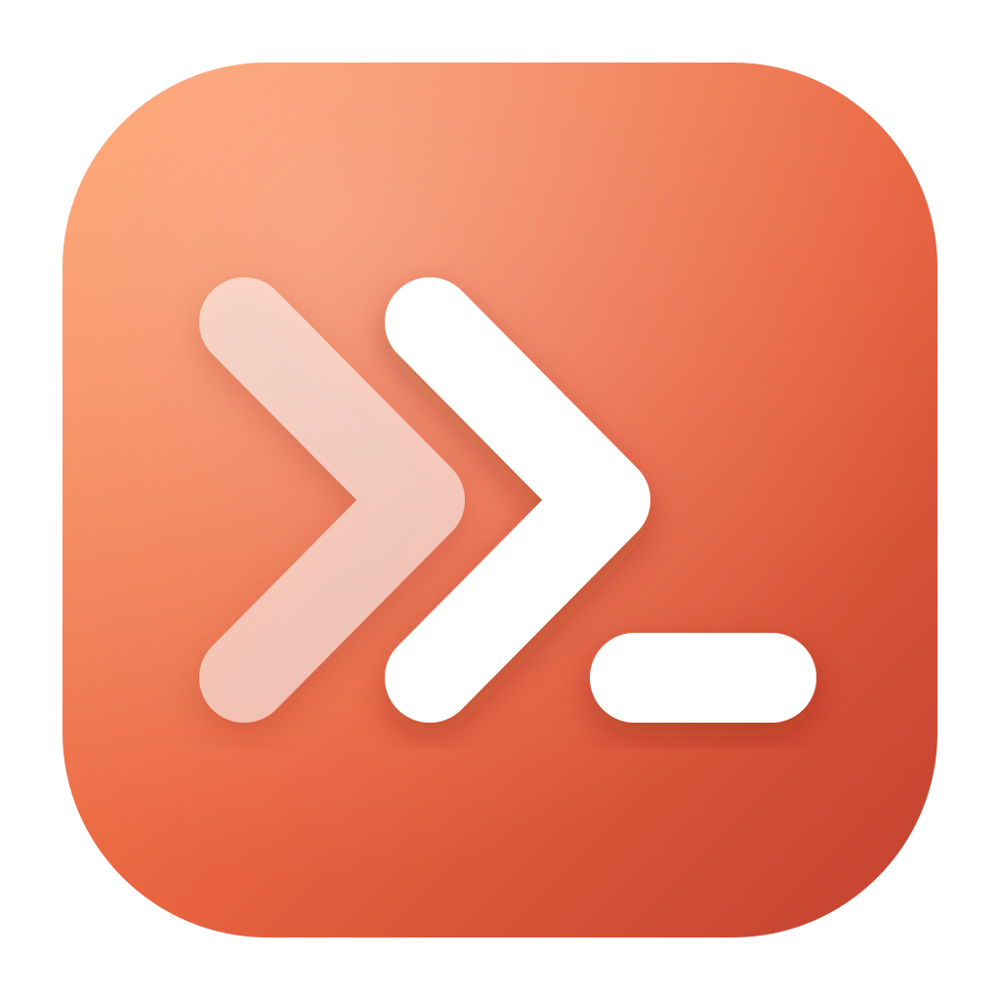

🌐 **中文** · [English](README.en.md)

<p align="center">
  
</p>

Crew 是一款面向 Claude Code 和 Codex 的 Windows 桌面应用。它按项目组织会话，让官方命令行工具在分屏中并排运行，并提供真正的输入框、一键切换模型和模式、每个智能体的实时状态、内置浏览器和托盘模式。任何历史会话都能一键恢复。

Crew 不替代这两个工具。每个会话运行的都是官方的 `claude` 或 `codex` 命令，跑在真实的终端里，使用你自己的账号和历史记录。Crew 只是在它们外面搭好工作区，自身不收集任何数据：你的代码和对话只会发给你运行的智能体。

## 安装

1. 从 [Releases](https://github.com/elioinvest/Crew/releases) 页面下载 `Crew Setup <版本号>.exe`。
2. 运行安装程序。可以自选安装目录，安装后会添加开始菜单和桌面快捷方式。
3. 安装程序没有代码签名，Windows SmartScreen 可能提示“未知发布者”。点击 **更多信息**，再点击 **仍要运行**。

### 智能体

Crew 运行的是你电脑上已有的智能体。按需安装：

| 智能体 | 安装命令 | 另需 |
| --- | --- | --- |
| Claude Code | `irm https://claude.ai/install.ps1 \| iex`（在 PowerShell 中运行） | [Git for Windows](https://git-scm.com/download/win) |
| Codex | `npm install -g @openai/codex` | [Node.js](https://nodejs.org/)（自带 npm） |

不必提前安装。如果新建会话时对应的智能体还没装，Crew 会显示安装命令和 **Install** 按钮，点击即可代为安装，装好后自动开始会话。每个智能体首次运行时需要登录：Claude Code 使用 Claude 账号或 API 密钥，Codex 使用 ChatGPT 账号或 OpenAI API 密钥。

## 使用

Crew 支持中文和英文界面（设置 → 语言）。下文中的按钮和菜单名称以英文界面为准。

### 项目与会话

- 侧边栏列出你用过 Claude Code 或 Codex 的所有文件夹。点击 **Projects** 旁的 **+** 可添加其他文件夹。
- 每个项目里，Claude 和 Codex 的会话分开列出，最新的在前。点击即可恢复会话。
- 新建会话：点击顶部的 **New session**、项目或智能体分组上的 **+**，或使用启动页。
- 双击会话可重命名；右键可重启、关闭、删除或复制会话 ID。
- 拖动项目可调整顺序，也可以右键项目选择 **Move up**、**Move down** 或 **Move to top**。顺序设定后保持不变。
- **Ctrl+K** 搜索项目和会话。

### 输入提示词

- 在终端下方的输入框中输入，按 **Enter** 发送，**Shift+Enter** 换行。
- 用 **Ctrl+V** 粘贴截图，把文件拖到输入框上，或点击 **+** 添加附件。
- 输入框下方的选项可切换模型、推理强度和权限模式。**Shift+Tab** 可循环切换权限模式，与终端中一致。
- 输入框为空时，**Esc** 和方向键会直接发给智能体，方便操作它的菜单和确认提示。
- 也可以点击终端，直接在里面输入。

### 分屏

- 用右上角的按钮分屏，或按 **Ctrl+\\**（向右）和 **Ctrl+Shift+\\**（向下）。每个分屏的标题栏也有同样的按钮，以及关闭分屏的 **×**。
- 点击某个分屏即可激活。激活的分屏有橙色边框和 **Active** 标记，输入框和各选项都作用于它。
- 把侧边栏的会话拖到某个分屏上即可在那里显示。右键会话可选择 **Open in split right** 或 **Open in split down**。
- 拖动分屏之间的空隙可调整大小。关闭分屏不会停止其中的会话，可以从侧边栏重新打开。
- 会话旁的转圈图标表示智能体正在工作；绿点表示已完成，正在等你。

### 浏览器与文件

- 对话中的链接会在旁边的内置浏览器中打开；**Ctrl+点击** 则用系统默认浏览器打开。
- 右上角的地球按钮可显示或隐藏浏览器。浏览器支持标签页（**Ctrl+T**、**Ctrl+W**、**Ctrl+Tab**），并保持网站登录状态。
- 对话中的图片路径会在查看器中打开，其他文件路径用默认程序打开。
- **智能体的浏览器：**Crew 按 ego 官方的方式集成了 [ego lite](https://github.com/citrolabs/ego-lite)——一款为智能体打造的免费浏览器：借助 ego 官方的 `ego-browser` 技能，凡是需要浏览器的任务（网站操作、表单、登录、截图、测试网页应用），智能体都会在 ego lite 中各自的空间里完成，不会占用你的屏幕。遇到需要你本人操作的步骤（登录、验证码）时，智能体会暂停并告诉你打开哪个空间。设置中会显示 ego lite 及其官方技能是否已安装，并提供下载 ego lite 和运行官方技能安装程序的按钮。

### 文件

- 右上角 Git 旁边的文件按钮会在右侧面板中以文件树形式打开当前会话的文件夹。文件夹逐层展开；被 Git 忽略的文件会显示为灰色。面板会跟随当前会话，并与 Git 共用右侧位置。
- **名称** 按文件名查找，**内容** 在文件内容中查找。点击文件即可在文件树旁查看完整内容（图片直接显示），带行号，并按文件类型高亮语法（使用 [highlight.js](https://highlightjs.org/)）；内容搜索的结果会定位到对应行。可以直接在其中编辑文件：按 **Ctrl+S** 或点击 **保存** 即可保存（保留原有换行符），Tab / Shift+Tab 调整缩进，有未保存的更改时切换文件会先询问。

### Git

- 当前会话所在的文件夹是 Git 仓库时，右上角会出现分支按钮。点击它会在终端右侧打开 Git 面板；拖动面板左边缘可调整宽度，再次点击按钮或面板上的 **×** 即可关闭。切换会话时，面板会跟随到该会话所在的仓库。也可以右键任意项目，选择 **Open in Git**。尚未使用 Git 的文件夹可以在这里直接初始化仓库。
- 工具栏提供 **提交（Commit）**、**拉取（Pull）**、**推送（Push）**、**获取（Fetch）**、**分支（Branch）**、**合并（Merge）**、**贮藏（Stash）**、**丢弃（Discard）** 和 **标签（Tag）**。角标显示改动的文件数，以及相对上游分支领先、落后的提交数。
- **History** 显示所有分支、标签和远程的提交图谱。选中一个提交可查看详情和改动的文件，再选中文件查看差异。右键提交可以检出、从它创建分支或标签、合并、变基、拣选（cherry-pick）、还原（revert）或重置到该提交。
- **File status** 列出已暂存和未暂存的文件，并提供提交框。可以暂存或取消暂存整个文件（双击、点 **+** / **−** 按钮，或 **Ctrl**/**Shift**+点击多选），也可以在差异中按块（hunk）暂存。**Ctrl+Enter** 提交。
- 侧栏列出分支、标签、远程和贮藏。双击分支即可检出，右键查看更多操作。合并、变基或拣选遇到冲突时，会显示横幅，提供 **Abort**（以及 **Continue**）。
- Crew 使用你本机的 `git`，需要安装 [Git for Windows](https://git-scm.com/download/win)。推送和拉取使用你已配置的凭据（Git Credential Manager）。智能体修改文件时，视图会自动刷新。

### 远程主机（SSH）

智能体可以通过 SSH 管理你的服务器，全程看不到你的密码或密钥。这一思路来自 [Hatoba](https://github.com/scarletkc/Hatoba)。

- 在侧栏底部的 **Hosts** 中添加服务器，或选择 **⋯ → Import from ~/.ssh/config** 导入。每台主机包含名称、地址、用户、登录方式（密钥文件、ssh-agent 或密码）、可选分组，以及**给智能体的备注**，例如"生产环境：不要重启数据库"。
- **点击主机**即可打开它的工作区：一侧是你在该服务器上的终端，另一侧是一个智能体会话（Claude，或在主机的 **+** 中选择 Codex 或你的自定义模型提供商）。与智能体对话，例如"nginx 为什么启动失败？"或"清理一些磁盘空间"，它就会在这台服务器上操作。和 Hatoba 一样，智能体与你共用这个终端：它能读取屏幕内容（"看看这个报错"），也能在其中输入（命令、对提示的回答、Ctrl+C 等按键，以及 `top`、编辑器等程序），它输入的一切你都能看到，并可随时接手。终端要求输入密码或验证码时，由你输入，智能体再继续。
- 主机在侧栏中可以像项目一样展开：先是 **Terminal**，然后是它的智能体会话（最新的在前）。点击即可在终端旁恢复该会话。
- 智能体会通过工作区里的说明知道自己在操作哪台服务器，其中包括你为该主机写的备注。它使用 `crew-ssh`：`send` 和 `screen` 用于共用的终端，`exec` 用于单独运行的命令，`cp` 用于传输文件。其他会话中的智能体也可以按主机名使用它。
- Codex 在沙箱中运行命令，沙箱无法连接 Crew，因此 Crew 会添加一条 Codex 规则（`~/.codex/rules/crew.rules`），只允许 `crew-ssh` 和 `crew` 在沙箱外运行。任何会改动主机的操作，Crew 仍会先询问你。
- 选择一次 **⋯ → Teach Claude Code and Codex to use crew-ssh**，会安装一个技能，智能体无需提示就知道如何使用该命令。
- 凭据由 Crew 保管并由 Crew 登录。密码使用 Windows 数据保护加密保存，窗口和智能体都不会拿到它。
- 只读命令（`df`、`ps`、`systemctl status`、`journalctl`、`docker ps` 等）直接运行，无论是单独运行还是在终端提示符处输入。任何可能改动主机的命令、在全屏程序中的输入以及所有上传，都会弹出卡片，由你选择 **Allow**、**Allow 15 min**（该主机 15 分钟内全部放行）或 **Deny**。也可以为每台主机设置为每条命令都询问，或全部直接运行。
- 首次连接主机时会显示其密钥指纹供你确认；之后若密钥发生变化，Crew 会阻止连接。
- 每台主机的编辑窗口会列出最近的智能体命令及其结果。

### 智能体（@ 提及）

在主会话中把任务的一部分交给其他智能体，可以依次执行，也可以多个同时执行。

- 在侧栏的 **Agents** 中添加智能体。**+** 提供代码审查、测试、发布或空白模板。每个智能体有名称、运行在 Claude、Codex（Crew 会检查是否已安装）或你的自定义模型提供商上，并可从它提供的选项中选择模型和推理强度、有说明，以及 **Can** 权限：只读、可在项目中编辑并运行命令，或不经询问执行任何操作。最后一项只给你信任的智能体。
- 在会话中输入 `@` 选择智能体，并说明执行方式，例如："完成注册流程。然后让 @CodeReviewerAgent 审查、@TesterAgent 同时测试。两者都通过后，让 @CodePublisherAgent 发布。"
- 主智能体通过 `crew ask` 把任务交给它们（多个同时执行时加 `--bg`，再用 `crew wait`），并拿回它们的回答。智能体在同一个文件夹中，以 Claude 或 Codex 的非交互模式工作。
- 右上角的卡片会显示每个正在运行的智能体、它在做什么以及用时，并提供 **Stop**、**Result** 和 **Open**（把 Claude 智能体的运行作为普通会话继续）。
- 每个智能体消耗其 CLI 自己的额度，并显示在用量栏中。

### 自定义模型提供商

把你自己的 API 添加为与 Claude、Codex 并列的智能体：中转站、自部署服务及其他兼容 OpenAI 或 Anthropic 的接口。

- 在 **设置 → 模型提供商** 中点击 **+ 添加提供商**，填写 Provider ID、显示名称、图标（图片或 Emoji；都不设置时显示名称首字母）、API 地址、API 协议、API 密钥和模型。**获取可用模型** 会读取提供商的模型列表；也可以手动添加模型并填写显示名称，用星标选择默认模型。
- 每个提供商由支持其协议的官方 CLI 运行，并拥有自己的环境：Crew 为它保留一个主目录，存放它的设置、会话和历史记录，与你自己的 Claude 和 Codex 互不影响。**OpenAI Responses** 提供商由 Codex 运行，以该目录作为 `CODEX_HOME`，其中的 `config.toml` 把该提供商设为默认（并沿用你的 Windows 沙箱设置）；**Anthropic Messages** 提供商由 Claude Code 运行，以该目录作为 `CLAUDE_CONFIG_DIR`，使用官方的 `ANTHROPIC_BASE_URL`、`ANTHROPIC_AUTH_TOKEN` 和 `ANTHROPIC_MODEL` 配置。这是两个 CLI 支持的协议（Codex 已不再支持 Chat Completions）。Crew 的 `crew-ssh` 和 ego lite 技能会链接到每个主目录中。
- 每个提供商都会带着图标出现在 **新建会话** 菜单、主机菜单和 @ 智能体的选项中，并在侧栏中单独成组。标题栏、输入框和各选项显示该提供商、它的模型和推理强度。切换模型或推理强度会在运行中的会话里直接生效，无需重启（Claude Code 使用 `/model`、`/effort`；Codex 使用 `/model … --reasoning=…`，提供商的模型会作为模型目录提供给 Codex），会话也会记住你的选择。该目录附带 Codex 自己的基础提示词 `codex-prompt.md`，来自 [openai/codex](https://github.com/openai/codex)（Apache-2.0）。
- API 密钥使用 Windows 数据保护加密保存，只在你用该提供商启动的会话中提供。你自己的 Claude 和 Codex 配置文件不会被修改。

### 窗口

- 左上角的按钮可隐藏或显示侧边栏。
- 关闭窗口后 Crew 会继续在系统托盘中运行，会话不会中断。点击托盘图标可重新打开；右键选择 **Quit Crew** 退出。这一行为可在设置中关闭。
- 底部的状态栏显示各智能体的套餐用量：5 小时额度已用多少、何时重置，以及每周额度。鼠标悬停可查看详情。Crew 会在后台用你现有的登录向各智能体查询当前用量：Codex 通过它的 `app-server`，Claude（Pro 和 Max 套餐）则在一个不保存对话记录的隐藏 Claude Code 窗口中运行 `/usage`。由 Crew 启动的 Claude 会话还会加载一个状态栏钩子，在每次回复后更新数据，并照常运行你自己的状态栏，不会修改你的 Claude 配置文件。可在设置中关闭该状态栏。
- 设置（齿轮图标）可选择界面语言（自动跟随 Windows、English 或中文）、浅色或深色主题、字体大小，以及启动各智能体所用的命令和参数。

## 从源码构建

需要 Node.js 20 或更高版本。

```
npm install
npm start          # 开发模式运行
npm run dist       # 构建 Windows 安装程序，输出到 release/
```

## 许可证

[MIT](LICENSE)
